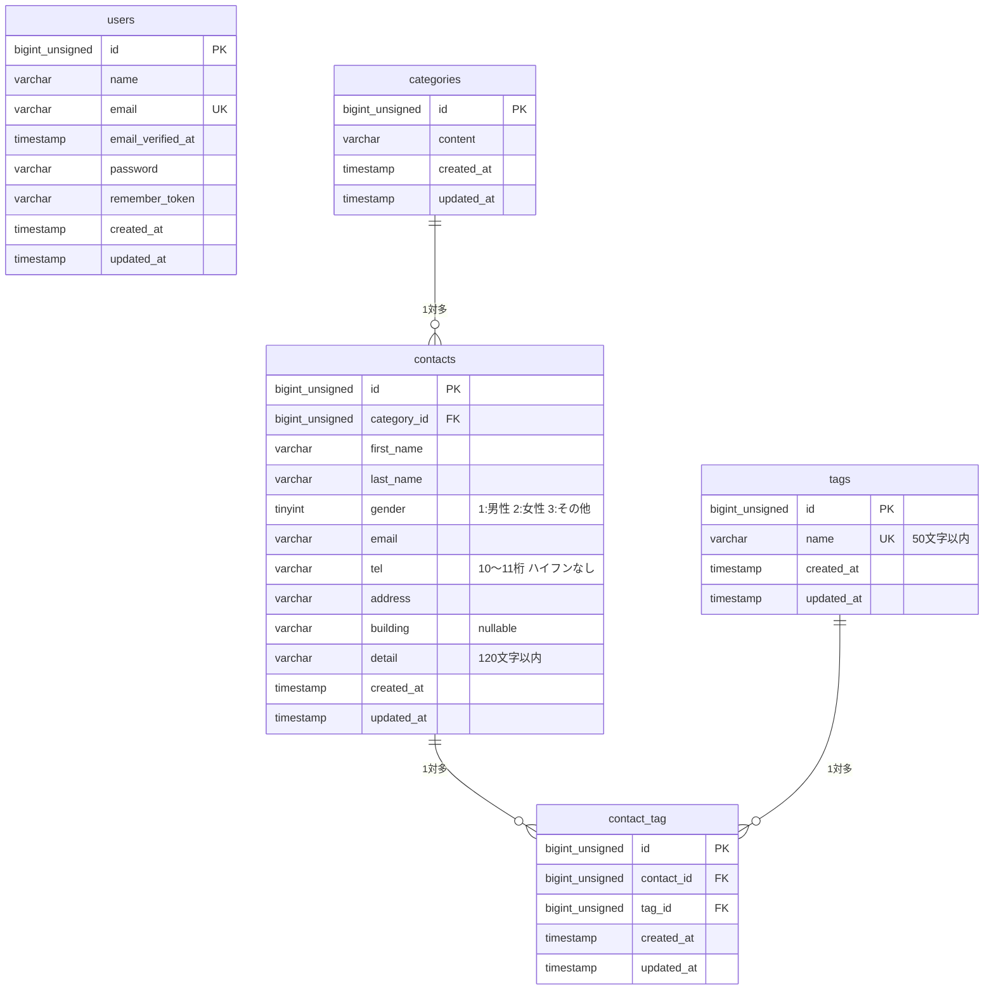

# COACHTECH お問い合わせフォーム

## 概要

一般ユーザーが利用する公開のお問い合わせフォームと、管理者がログイン後にお問い合わせ内容を確認・管理する管理画面を備えた Web アプリケーションです。
COACHTECH 基礎学習ターム確認テストとして、Laravel・DB 設計・テストを実践的にアウトプットすることを目的としています。

### 実装機能

**基本機能**

- お問い合わせフォーム（入力 → 確認 → 送信 → サンクスページ）
  - カテゴリ（ドロップダウン）・タグ（複数選択チェックボックス）の選択
  - FormRequest によるバリデーションと日本語エラーメッセージ表示
- 管理者登録・ログイン・ログアウト（Laravel Fortify、ログインは 5 回/分のレート制限）
- 管理画面（認証必須）
  - お問い合わせ一覧（7 件ごとのページネーション）
  - 名前・メールアドレス（部分一致）、性別、カテゴリ、日付による検索とリセット
  - お問い合わせ詳細表示・削除
  - タグの追加・編集・削除

**応用機能**

- 検索条件に一致するお問い合わせの CSV エクスポート（BOM 付き UTF-8、新着順）
- お問い合わせ CRUD の公開 API（`/api/v1/contacts`、認証不要）

## 使用技術

| 分類 | 技術 |
| --- | --- |
| 言語 | PHP 8.2 |
| フレームワーク | Laravel 10.x |
| 認証 | Laravel Fortify |
| データベース | MySQL 8.0 |
| Web サーバー | Nginx（Laravel Sail） |
| フロントエンド | Blade, Vite, Tailwind CSS ^3.4.0, Alpine.js |
| 開発環境 | Docker, Laravel Sail, phpMyAdmin |
| テスト・品質 | PHPUnit, Laravel Pint |

## 環境構築

Docker（Docker Desktop など）が動作する環境を前提としています。

### 1. リポジトリのクローン

```bash
git clone https://github.com/yuki-btw/contact-form-app.git
cd contact-form-app
```

### 2. Composer パッケージのインストール

```bash
docker run --rm \
    -u "$(id -u):$(id -g)" \
    -v "$(pwd):/var/www/html" \
    -w /var/www/html \
    -e COMPOSER_CACHE_DIR=/tmp/composer_cache \
    laravelsail/php82-composer:latest \
    composer install --ignore-platform-reqs
```

### 3. .env ファイルの作成

```bash
cp .env.example .env
```

`.env` のデータベース接続情報が以下になっていることを確認します（`DB_HOST` は Docker のサービス名 `mysql` です）。

```
DB_CONNECTION=mysql
DB_HOST=mysql
DB_PORT=3306
DB_DATABASE=laravel
DB_USERNAME=sail
DB_PASSWORD=password
```

> **Apple Silicon（M1/M2/M3）Mac の場合**
> `sail up -d` で `no matching manifest for linux/arm64/v8` エラーが出る場合は、`compose.yaml` の `mysql` サービスに `platform: 'linux/amd64'` を追加してください。

### 4. Sail の起動とエイリアス設定

```bash
./vendor/bin/sail up -d

# bash の場合（zsh の場合は ~/.zshrc）
echo "alias sail='[ -f sail ] && bash sail || bash vendor/bin/sail'" >> ~/.bashrc
exec $SHELL
```

### 5. アプリケーションキーの生成

```bash
sail artisan key:generate
```

### 6. データベースのマイグレーションと初期データ投入

```bash
sail artisan migrate --seed
```

データベースをリセットする場合は `sail artisan migrate:fresh --seed` を実行してください。

### 7. フロントエンドのセットアップ

```bash
sail npm install
sail npm run dev
```

`sail npm run dev` は実行したままにしてください（ビルド済みファイルで確認する場合は `sail npm run build`）。

### 初期データ

| データ | 内容 |
| --- | --- |
| 管理者ユーザー | name: `Test User` / email: `test@example.com` / password: `password` |
| カテゴリ | 商品のお届けについて / 商品の交換について / 商品トラブル / ショップへのお問い合わせ / その他 |
| タグ | 質問 / 要望 / 不具合報告 / ご意見 / その他 |
| お問い合わせ | Faker（ja_JP）によるダミーデータ 20 件（各 1〜3 件のタグ付き） |

## 開発環境 URL

| 画面 | URL |
| --- | --- |
| お問い合わせフォーム | http://localhost/ |
| サンクスページ | http://localhost/thanks |
| 管理者登録 | http://localhost/register |
| ログイン | http://localhost/login |
| 管理画面 | http://localhost/admin |
| phpMyAdmin | http://localhost:8080/ |

## ルーティング（Web）

| メソッド | パス | 概要 | 認証 |
| --- | --- | --- | --- |
| GET | `/` | お問い合わせフォーム入力ページ | 不要 |
| POST | `/contacts/confirm` | お問い合わせフォーム確認ページ | 不要 |
| POST | `/contacts` | お問い合わせ送信 | 不要 |
| GET | `/thanks` | サンクスページ | 不要 |
| GET | `/register` / `/login` | 管理者登録・ログイン画面（Fortify） | 不要 |
| POST | `/logout` | ログアウト（Fortify） | 必要 |
| GET | `/admin` | 管理画面（一覧・検索） | 必要 |
| GET | `/admin/contacts/{contact}` | お問い合わせ詳細 | 必要 |
| DELETE | `/admin/contacts/{contact}` | お問い合わせ削除 | 必要 |
| GET | `/contacts/export` | CSV エクスポート | 必要 |
| POST | `/admin/tags` | タグ追加 | 必要 |
| GET | `/admin/tags/{tag}/edit` | タグ編集ページ | 必要 |
| PUT | `/admin/tags/{tag}` | タグ更新 | 必要 |
| DELETE | `/admin/tags/{tag}` | タグ削除 | 必要 |

## API エンドポイント一覧

ベース URL: `http://localhost/api/v1`（認証不要）

| メソッド | パス | 概要 | 成功時 | エラー時 |
| --- | --- | --- | --- | --- |
| GET | `/contacts` | お問い合わせ一覧（検索・ページネーション付き） | 200 | 422 |
| GET | `/contacts/{contact}` | お問い合わせ詳細（カテゴリ・タグ含む） | 200 | 404 |
| POST | `/contacts` | お問い合わせ新規作成（タグ紐付け） | 201 | 422 |
| PUT | `/contacts/{contact}` | お問い合わせ更新（タグ同期） | 200 | 404 / 422 |
| DELETE | `/contacts/{contact}` | お問い合わせ削除 | 204 | 404 |

### 一覧取得のクエリパラメータ

| パラメータ | 説明 |
| --- | --- |
| `keyword` | 姓・名・メールアドレスの部分一致検索 |
| `gender` | 性別（1: 男性, 2: 女性, 3: その他） |
| `category_id` | カテゴリ ID |
| `date` | 作成日（YYYY-MM-DD） |
| `page` | ページ番号（デフォルト 1） |
| `per_page` | 1 ページあたりの件数（デフォルト 20、最大 100） |

### 作成・更新のリクエスト例

```bash
curl -X POST http://localhost/api/v1/contacts \
  -H "Content-Type: application/json" \
  -H "Accept: application/json" \
  -d '{"first_name":"山田","last_name":"太郎","gender":1,"email":"user@example.com","tel":"09012345678","address":"東京都渋谷区1-1-1","building":"渋谷ビル301","category_id":1,"detail":"商品の配送日について","tag_ids":[1,3]}'
```

存在しない ID を指定した場合は `404` で `{"error": "お問い合わせが見つかりませんでした。"}` を返します。

## ER 図



- `categories` と `contacts` は 1 対多です（1 つのカテゴリに複数のお問い合わせ）。
- `contacts` と `tags` は中間テーブル `contact_tag` を介した多対多です（`UNIQUE(contact_id, tag_id)`）。
- 外部キーはすべて `ON DELETE CASCADE` です。
- `users` は管理者アカウント用で、他テーブルとのリレーションはありません。

## テスト・コード品質

```bash
# テスト実行（テスト用データベース testing を使用）
sail artisan test

# カバレッジ付きテスト実行
sail artisan test --coverage

# コード整形チェック
sail bin pint --test
```

## 作成者

廣上 勇輝
